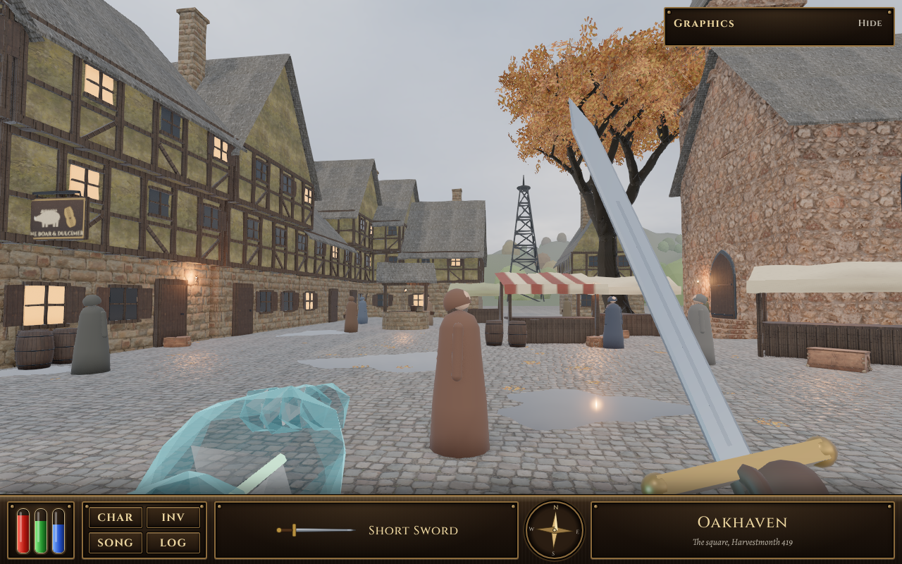

# Oakhaven square: the proof scene

A walkable test of the realistic look (ROADMAP R11), built 8 November 2026. Open `index.html` from a local web server (for example `python3 -m http.server` in this folder, then visit http://127.0.0.1:8000/). It also runs as a private Claude artifact.

## What is in it
- **Engine:** Three.js 0.186.1 (WebGL 2), loaded from jsDelivr. Post-processing on Ultra and High: GTAO ambient occlusion, bloom on lamps and the glass arm's vein only, AgX tone mapping, SMAA. No depth of field and no blur, as ruled.
- **The square:** houses with stone ground floors, jettied plaster upper floors and timber frames, slate roofs and chimneys (built in code, merged by material so the whole town is about 15 draws); the chapel with its bell-tower and the empty belfry (canon: nothing hangs in it); the Boar & Dulcimer's sign; the iron-oak (canon: "in the square, the iron-oaks began to ring") with 3,400 leaf cards and its fallen leaves; the well; four market stalls; casks; crates; lanterns with flickering lights; puddles that reflect the sky; the far hills and an autumn forest; and, above the roofs to the north through the lane, the Consortium's mooring mast over the quarry (canon: "a hundred and twenty feet of riveted iron on four splayed legs").
- **Lore (owner, 8 Nov: keep everything lore accurate):** the benchmark picture's castle and the chapel's tree banner are not in the books, so they are not here. Still [PROPOSED] in this scene: the layout of the square (in the books the Boar & Dulcimer stands on a corner of the square across from the Greenhall, which this scene doesn't build yet), the stalls, the well and the townsfolk's clothes. The game's own map decides these in the real build.
- **First person:** the light-glass arm (a faceted glass shader, clear in the middle and bright at the edges, with the green vein inside) and the short sword in a gloved hand.
- **HUD:** a bronze bar with the three vials, CHAR / INV / SONG / LOG, the weapon, a compass that turns, and the place name. On phones it collapses.
- **Quality:** Ultra, High and Phone (top right), applied live. **Run benchmark** flies a fixed 20-second path and gives a report (frames, average, 95th and 99th percentile, draws, triangles, GPU name) to copy.

## Assets and licences
Every file here is CC0 (no rights reserved) or made in code.
- **Poly Haven (CC0):** materials `cobblestone_floor_08`, `rustic_stone_wall`, `white_plaster_rough_02`, `medieval_wood`, `roof_slates_02`, `medieval_blocks_02`, `bark_brown_02`, `weathered_planks`; models `Lantern_01`, `wooden_crate_01`, `wooden_crate_02`; sky `kloofendal_overcast_puresky` (2k HDR). Fetched through the Poly Haven API on 8 Nov 2026.
- **Made in code:** the houses, chapel, well, stalls, casks, iron-oak, hills, forest, mooring mast, people, glass arm, sword, and the painted textures (cloth, the inn sign, leaves).
- Some binary files carry a `.wasm` name (`*.buf.wasm`, `sky_2k.hdr.wasm`) because the artifact host only serves standard web types; they are plain glTF buffers and a Radiance HDR, and the loaders read them as bytes.

## Not in it yet
The real game: this scene shares no code with it. The people are simple robed figures, not the R10 townsfolk. The frame times measured here are from software rendering (no graphics card), so they mean nothing: the benchmark on real devices is the next step.
