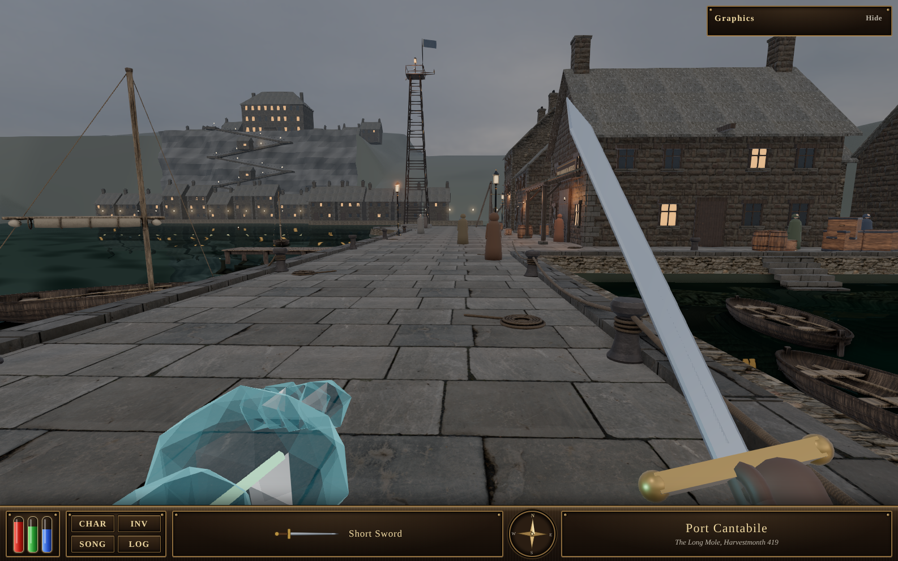

# Port Cantabile, the Long Mole: the proof scene

A walkable test of the realistic look (ROADMAP R11, phase 4) at the owner's third benchmark picture
(`docs/graphics/bench3-harbour.jpg`), built 11 November 2026. Open `index.html` from a local web server (for example
`python3 -m http.server` in this folder, then visit http://127.0.0.1:8000/). It also runs as a private Claude artifact.
**Concept view** (top right) puts the camera where picture 3's camera stands.

`compare.jpg` puts the proof beside picture 3, in colour and in greyscale (the value bands). Mean luma (0..255) at the
concept view, Ultra:

| Region | Proof | Picture 3 |
|---|---|---|
| Whole frame above the HUD | 82 | 81 |
| Sky (top band) | 113 | 105 |
| Far town | 82 | 87 |
| The Mole's flags | 81 | 84 |
| Water, left | 48 | 41 |
| Houses, right | 67 | 65 |

On Phone (`shot-phone.png`) the water reflects the sky's cubemap instead of the scene and reads lighter (60).

## What is in it
- **Engine:** Three.js 0.186.1 (WebGL 2), as in the Oakhaven proof: GTAO, bloom on flames, lit windows and the glass
  arm's vein only, AgX tone mapping, SMAA. No depth of field and no blur.
- **Harbour water, by tier** (the benchmark report's phase 4 table): Ultra a planar reflection (three.js `Water`), High
  the same at half resolution, Phone the overcast sky's cubemap on a dark, glossy surface. The ripples are a normal map
  made in code. The water is dark green and its reflections take that colour.
- **The Long Mole:** granite flags with a dressed kerb along both edges, stone faces down into the water with a line of
  weed at the tide, the round Mole-head, steps down into the basin.
- **From Forge** (the IDTech3-NextGen-Forge harbour kit, `tests/test_harbour.gd` in that repo, exported with
  `"collider": false` so three.js gets no collider box): iron bollards with rope round their necks, rope swags between
  them and the painter to the boat, rope coils, two timber jetties, rowboats (with mast, furled sail, stays and shrouds,
  and a chime on each shroud; and plain ones), the mast-tower, the derrick with the Mole-bell, barrels, crates and lamp
  posts. Each model's `.provenance.json` records its recipe and its bake. None is approved in the Review Room yet.
- **Built in code:** the Harbour Office (gable to the Mole, timber porch, the painted board "THE HARBOUR OFFICE"), the
  harbour houses (rubble stone, quoins, slate roofs, chimneys), the far town, the cliff, the Salt Stair, the
  counting-house, the hills, the mast-tower's pennant, the people, the glass arm and the sword.
- **First person and HUD:** the Oakhaven proof's, unchanged (light-glass arm with the green vein, short sword, the bronze
  bar), with the place name Port Cantabile.

## Lore
Canon kept: the Long Mole; the mast-tower at the head of the Long Mole, where the Kestrel moors; the derrick at the
Mole-head and the Mole-bell beside it (one stroke for every soul that goes into the water); every shroud in the harbour
carries a chime; the town climbs its cliff by the Salt Stair, six flights with shops on the landings and at night a zigzag
of small gold lamps, to the counting-house at the top. Picture 3's castle is not in the books, so the counting-house
stands where it stood: a broad stone hall with a hipped roof and chimneys, no tower and no battlements.

**[PROPOSED]**, for the owner to rule on:
- the harbour's layout: the Mole runs out north from the harbour front, the Harbour Office and the houses stand on a
  broad quay on its inner (east) side, and the cliff and the Salt Stair are across the water to the west;
- the Harbour Office's look and its board (lettering only: no harbour seal is in the books);
- the mast-tower's pennant (plain slate-blue wool: no harbour colours are in the books);
- the jetties, the plain rowboats, the shops' look on the Stair's landings, and the people's clothes.

## Assets and licences
Every file here is CC0 (no rights reserved), made in code, or made with Forge from the Forge library's own recipes.
- **Poly Haven (CC0):** materials `large_grey_tiles` (the flags, fetched through the Poly Haven API on 11 Nov 2026),
  `castle_wall_slates`, `rustic_stone_wall`, `roof_slates_02`, `medieval_wood`, `weathered_planks`; models `Lantern_01`,
  `wooden_crate_01`, `wooden_crate_02`; sky `kloofendal_overcast_puresky` (2k HDR). All but the flags are the copies the
  Oakhaven proof and `assets/r11/tex` already hold.
- **Forge (`models/forge/`):** baked game meshes with 512 or 1024 px albedo, normal and occlusion/roughness/metal maps,
  made from the library recipes named in each `.provenance.json`. No generated meshes from region-restricted or
  non-commercial models.
- Binary files carry a `.wasm` name (`*.glb.wasm`, `*.buf.wasm`, `sky_2k.hdr.wasm`) because the artifact host only
  serves standard web types; they are plain glTF binaries and a Radiance HDR, and the loaders read them as bytes.

## Not in it yet
The real game: this scene shares no code with it. The far town is simple; the people are the Oakhaven proof's robed
figures. The frame times measured here are from software rendering (no graphics card), so they mean nothing: the
benchmark on real devices is the next step.
